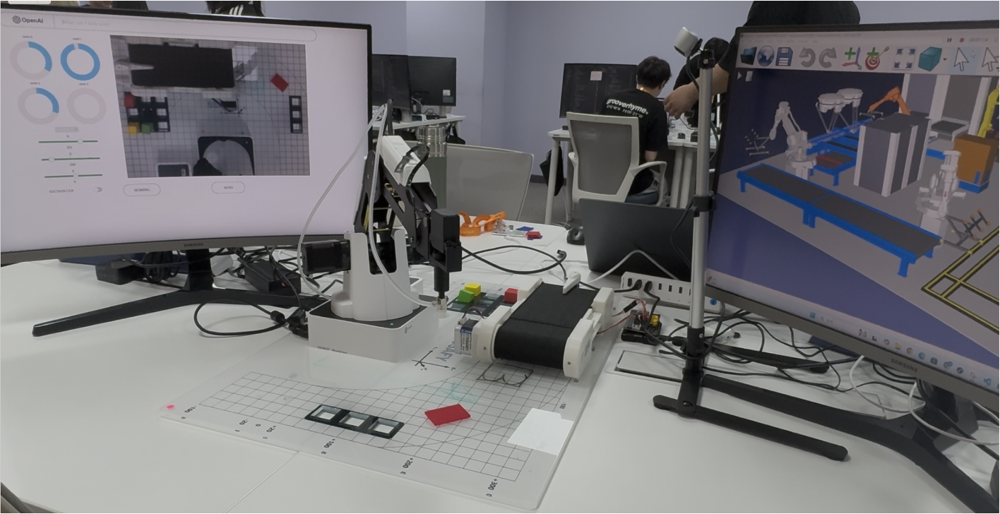
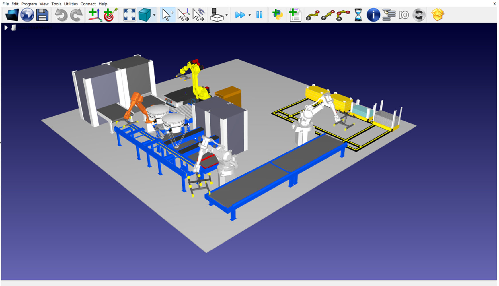
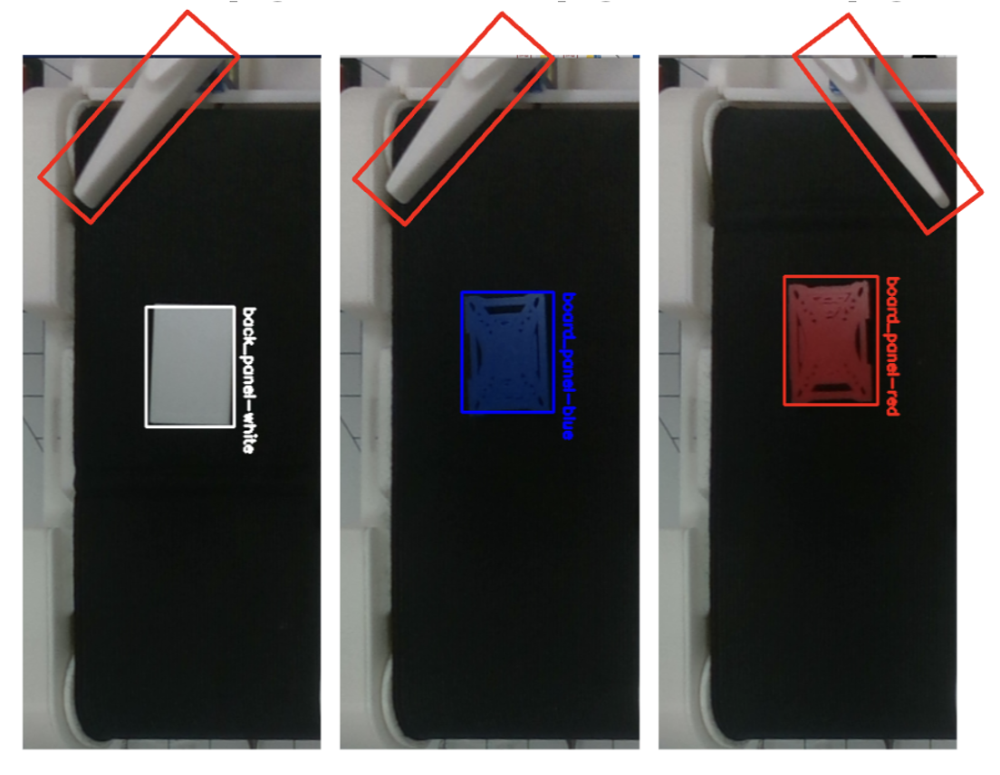
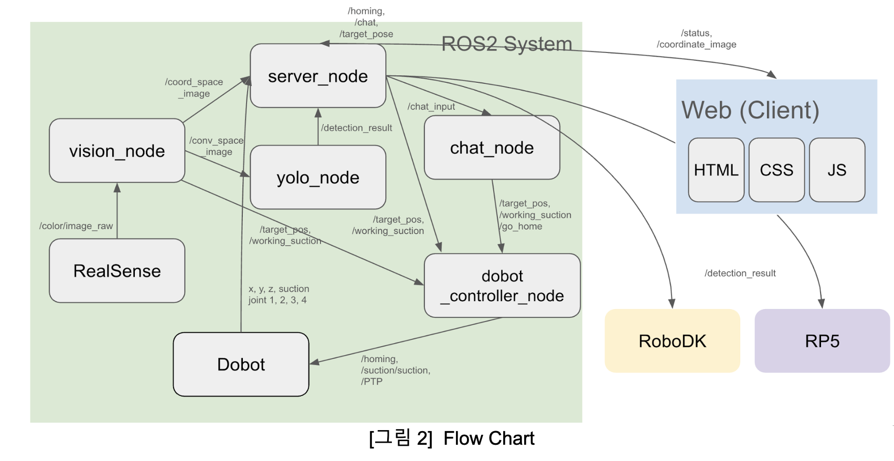
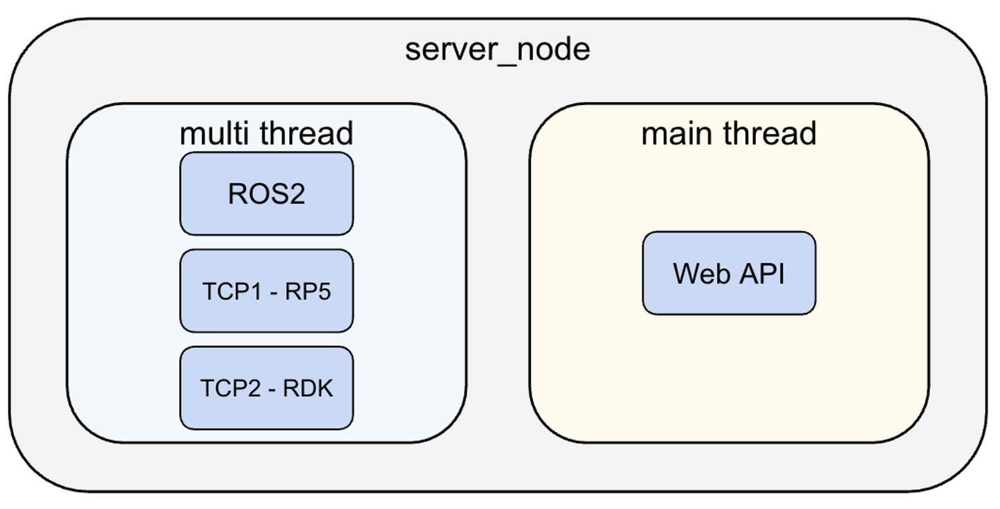
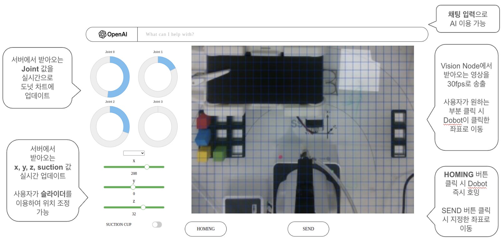

산업·협동 로봇 수요가 늘고 안전사고 예방이 중요해지는 흐름에 맞춰, 로봇팔의 모션 제어를 웹에서 수행하는 자동화 공정과 디지털 트윈을 만들었습니다. 3인 팀에서 팀장이자 PM 으로 ROS2 시스템과 서버, 영상처리, Dobot 모션 제어를 맡았습니다.

- 카메라 영상에서 Coordinate Board 를 Perspective Transformation 해 원근 제거
- 원근이 제거된 RoI 를 실시간 웹 스트리밍하고, 화면 클릭으로 로봇 목적지 지정
- 슬라이드 바로 세밀 제어, 채팅창에 대화식으로 입력하면 ChatGPT API 가 로봇 명령으로 변환
- 컨베이어 위 객체를 감지하면 벨트를 구동하고 YOLOv5 로 불량품(빨간색) 분류
- 같은 시나리오를 RoboDK 디지털 트윈으로 동시 시뮬레이션

#### 문제 해결

**문제** 로봇의 End-Effector 위치가 실제 흡착 부위인 Suction-Cup 이 아니라 마지막 관절 위치로 반영됐습니다.

**해결** 마지막 관절부터 Suction-Cup 까지의 거리를 직접 측정하고, 정기구학(FK)으로 End-Effector 위치를 계산해 보정했습니다.

#### 서버 구조

메인 스레드의 Web API 외에 ROS2(Dobot·영상처리 노드), TCP1(컨베이어 벨트 라즈베리파이5), TCP2(RoboDK 실행 PC) 를 각각 별도 스레드로 두어 실시간 비동기 통신을 처리했습니다.

클라이언트 수가 동적으로 변하지 않고 리소스에 주는 영향도 크지 않다고 판단해, 비동기 이벤트 루프 대신 멀티 스레드로 더 안정적인 구조를 택했습니다.

#### 회고

- 실시간 스트리밍 속도 개선을 위해서는 RTP 도입이 필요합니다.
- Perspective Transformation 으로 원근은 제거했지만, 지면에서 솟아 있는 객체는 옆면이 함께 보이는 한계가 남습니다.

`ROS2` `YOLOv5` `RoboDK` `OpenCV` `Flask`

[GitHub](<https://github.com/YooJuno/SSAFY-Smart_Factory>) [Demo Video](<https://www.youtube.com/watch?v=G8R1HWxcDtk>)

