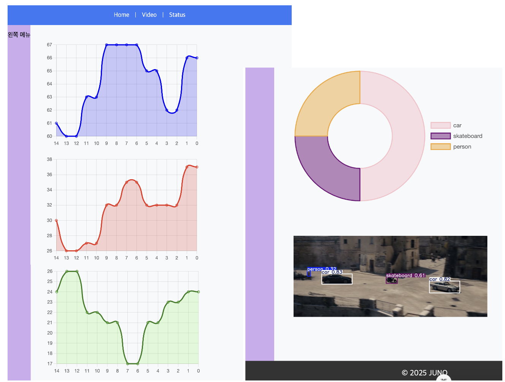
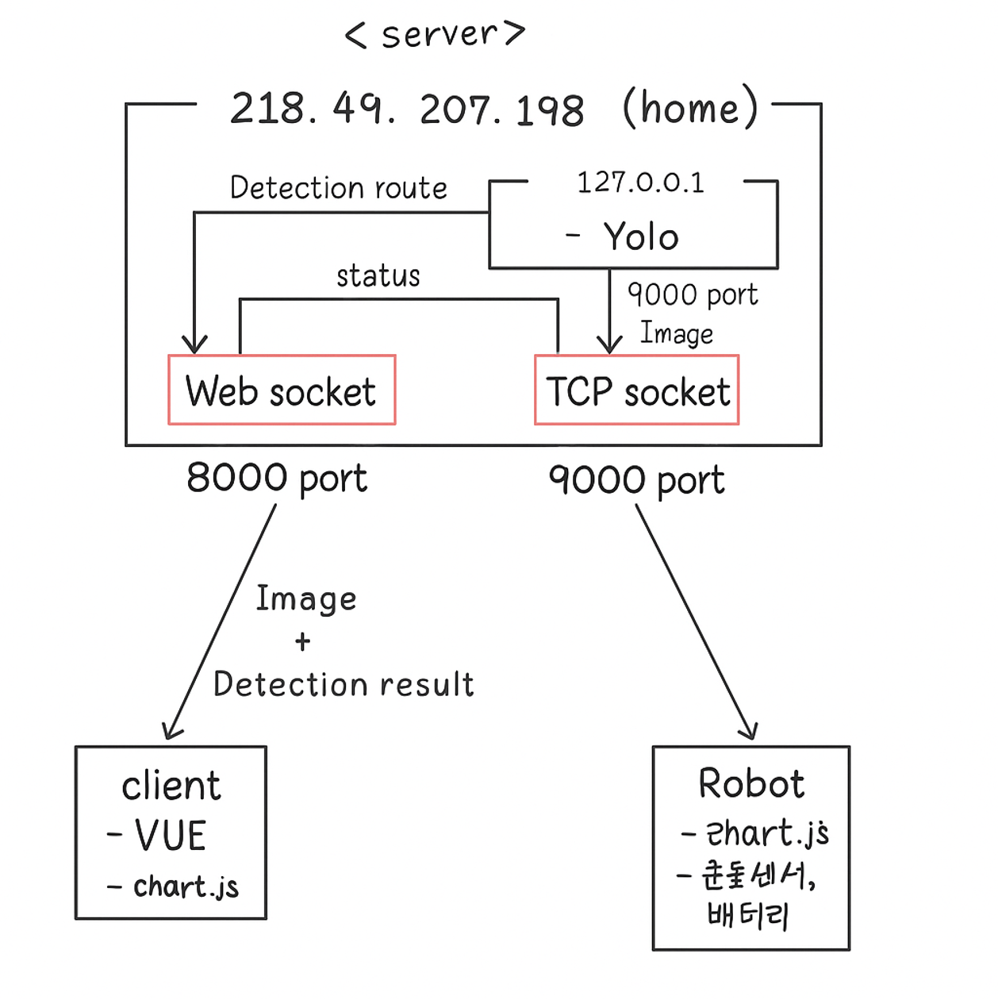

로봇의 센서 값과 영상 검출 결과를 웹에서 확인하는 시스템을 1인으로 만들었습니다. 웹 인터페이스, 서버 통신과 영상처리를 담당했습니다.

- 로봇(Raspberry Pi)이 센서 값과 영상을 서버로 송신
- 서버가 영상을 로컬의 YOLO 서버로 넘기고 결과를 받아 웹 서버로 전달
- 서버 간 중계를 비동기로 처리해 요청·응답 대기와 다른 작업의 실행 분리
- 프런트에서 센서 데이터를 실시간 차트로, 검출 결과와 영상을 함께 표시

#### 시연 범위

라즈베리파이 카메라 고장으로 실시간 촬영 대신 별도 동영상으로 시연했습니다. 로그 저장은 구현했지만 데모에서는 활용하지 않았습니다.

#### 개선 과제

- 촬영·추론·중계·재생 구간별 지연과 병목 측정
- 다중 로봇 지원 시 연결·처리 결과를 로봇별로 구분하고 부하 분산 구조 검토
- 저장 로그의 조회 목적·보관 기간과 DB 활용 방식 정리

`Vue.js` `Node.js` `YOLOv9` `MySQL` `Nginx`

[GitHub](<https://github.com/YooJuno/SSAFY-Web>)

