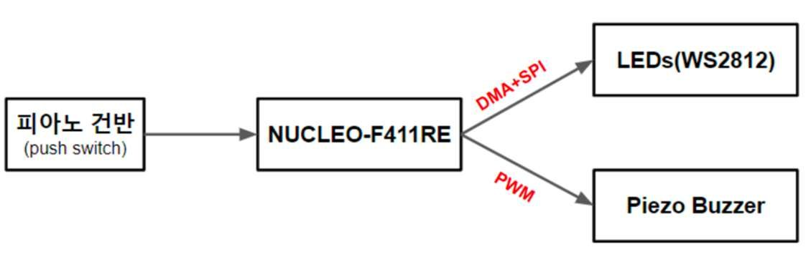
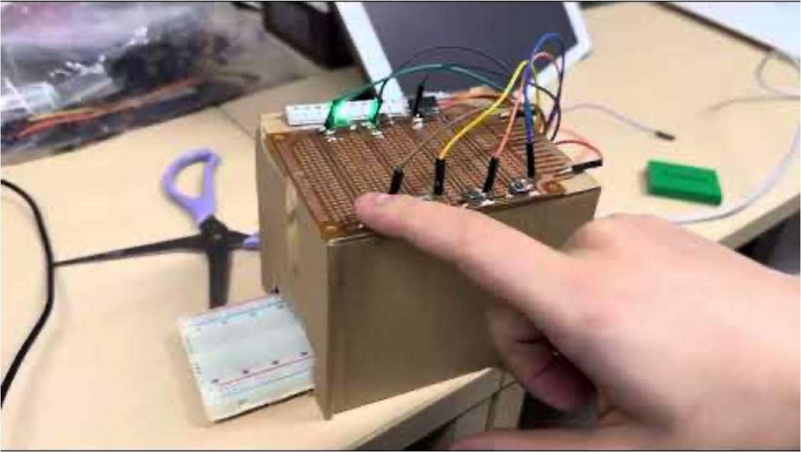

딜레이 없는 건반과 스피커, LED 를 갖춘 임베디드 피아노 모듈을 4인 팀으로 만들었습니다. 피아노 회로 제작과 DMA+SPI 통신 개발을 맡아 LED 모듈 타이밍에 맞는 DMA 제어와 Bit Map Setup 을 담당했습니다.

- mbed OS 로 STM32(NUCLEO-F411RE) 펌웨어 개발
- 건반을 누르면 WS2812 LED 가 해당 색으로 점등되고 피에조 부저에서 음 출력
- PWM 으로 건반별 음을 생성

#### DMA 를 쓴 이유

일반적인 SPI 통신은 CPU 버스를 거치기 때문에 딜레이가 큽니다. SPI 에 DMA 를 결합해 CPU 개입 없이 LED 모듈로 데이터를 보내면서 실시간에 가까운 응답을 얻었습니다.

`STM32` `mbed OS` `DMA` `SPI`

[GitHub](<https://github.com/YooJuno/STM32-MBED/tree/main/Final>) [Demo Video](<https://www.youtube.com/watch?v=sW-dLjTRV7A>)

