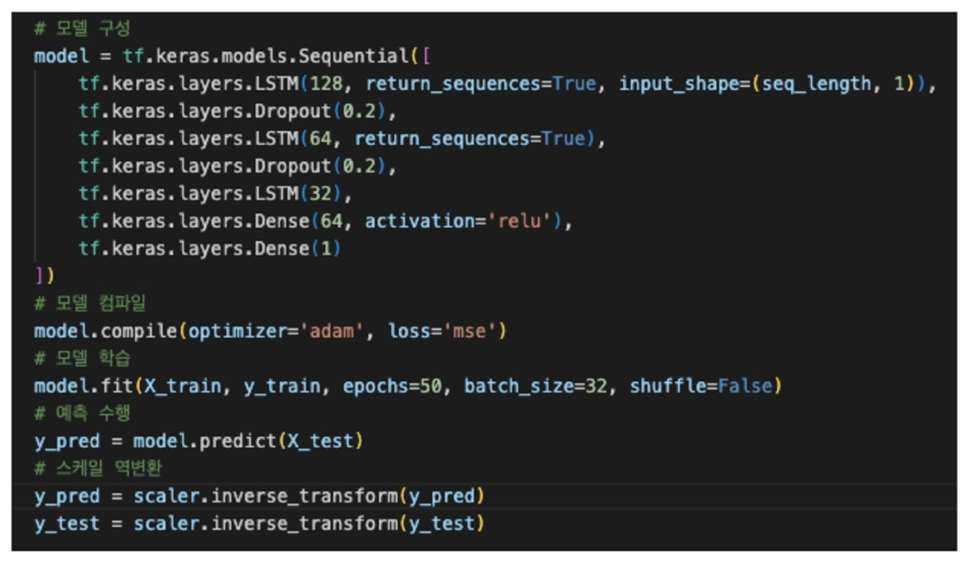
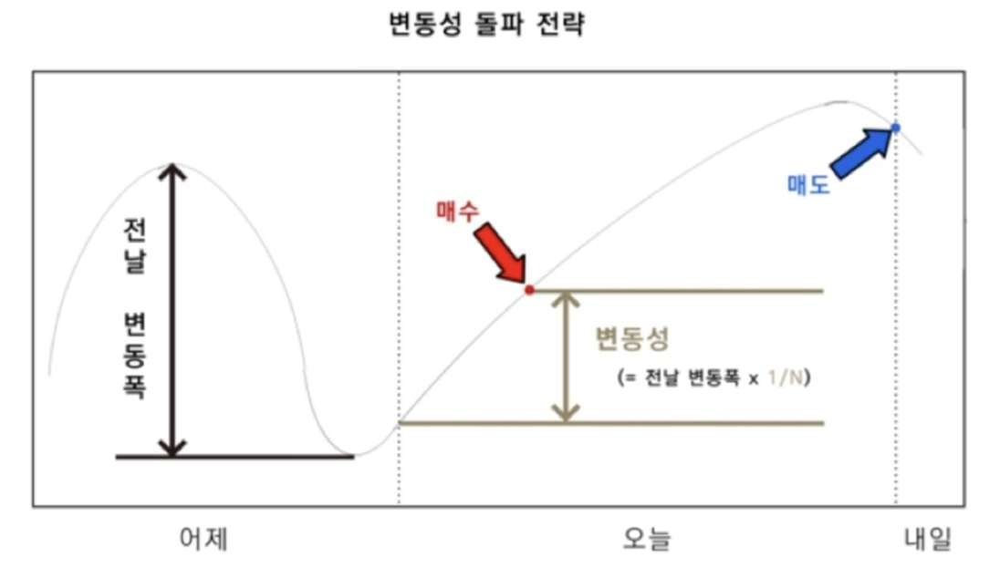

LSTM 가격 예측과 변동성 돌파 전략을 적용한 Upbit 자동 매매 프로그램을 만들었습니다. 4인 팀의 팀장으로 주제 제안, 매매 조건·전략 수립, 모델 선정과 학습을 맡았습니다.

- 셀 상태와 게이트로 시계열 정보를 유지·갱신하는 LSTM을 가격 예측에 적용
- 학습 방식을 4가지로 나눠 비교 (1분봉 500·2000개, 10분봉 500개, 100분봉 2000개, Train:Test = 9:1)
- 전날 변동폭을 기준으로 진입 조건을 정하는 변동성 돌파 전략 적용
- 10분 단위로 모델을 새로 학습하며 Upbit API 로 매매 실행

#### 결과

실행 기간에 리플은 이익, 도지는 손실을 기록했습니다. 이 결과만으로 전략의 수익성이나 종목별 차이의 원인을 확정할 수는 없습니다.

#### 회고

- 가격 데이터만 사용하는 모델은 뉴스·공시 같은 외부 요인을 직접 반영하지 못합니다.
- 종목·기간별 결과와 수수료·슬리피지를 구분해 전략을 검증해야 합니다.
- 암호화폐는 24시간 거래되지만 봉별 종가는 존재합니다. 전날 변동폭을 계산할 때 일봉의 기준 시각과 시간대를 맞춰야 합니다.

`LSTM` `Upbit API` `Python`

[GitHub](<https://github.com/YooJuno/Upbit-Auto-Trader>)

