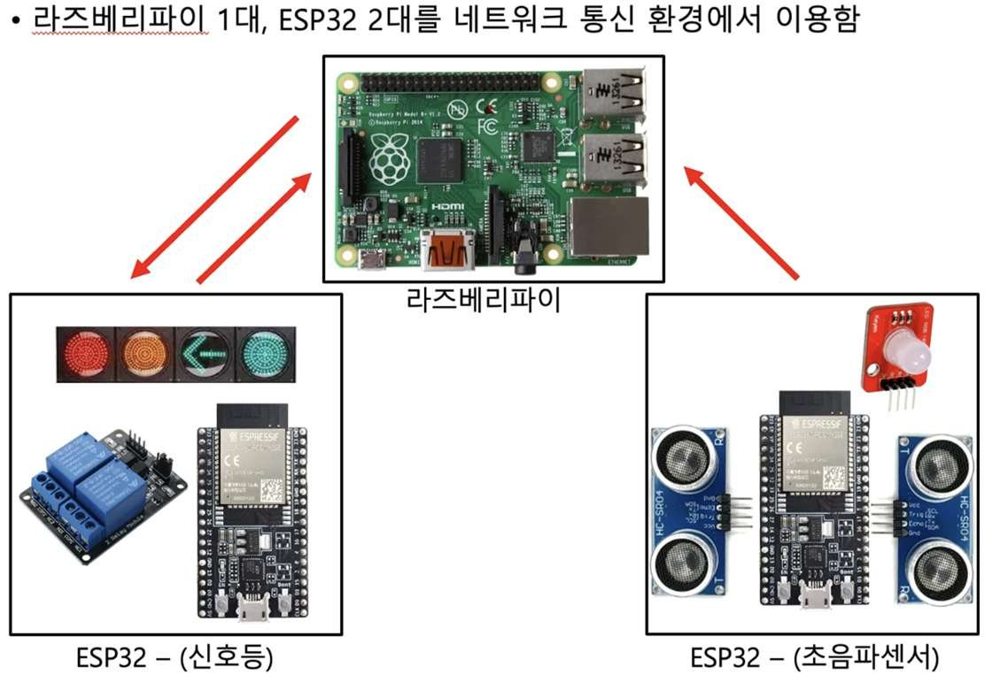
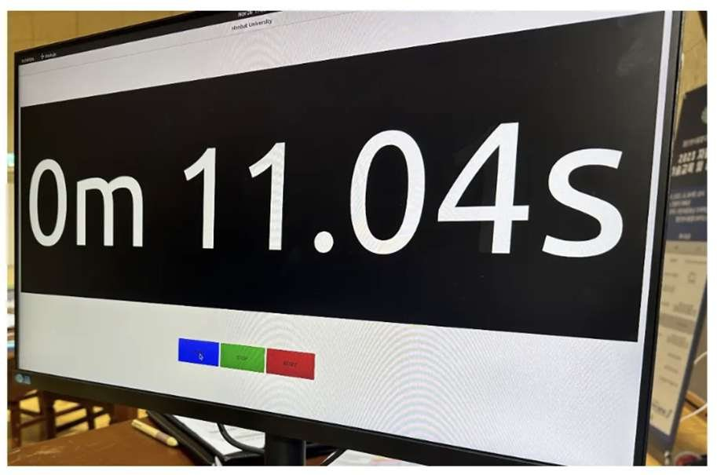

자율주행 경기장 운용이 모두 수작업으로 이루어지던 것을 자동화했습니다. 자이트론 인턴 기간에 1인 프로젝트로 ROS2 시스템 구축과 PyQT5 상황판, ESP32 펌웨어를 모두 개발했습니다.

- 라즈베리파이를 AP 모드로 띄워 ESP32 기기들이 접속하게 하고 Micro-ROS Agent 로 ROS 환경 구성
- 경기 시작과 미션 점검, 시간 측정을 상황판 GUI 에서 주관
- 초음파 노드: 센서 값을 토픽으로 발행하고 미션 성공 시 LED 점등과 함께 신호 송신(Service)
- 신호등 노드: 출발 신호를 받아 릴레이 모듈로 점멸을 제어하고 결과 반환(Service)

#### 문제 해결

**문제** PyQT 와 ROS2 스레드 간 동기화 문제로 프로그램이 간헐적으로 종료됐습니다.

**해결** Qt GUI는 메인 스레드에 유지하고 ROS2의 `spin()`을 별도 스레드로 옮겼습니다. GUI 이벤트 루프와 ROS 콜백 처리가 서로 막지 않도록 실행 경로를 분리했습니다.

#### 회고

- GUI 객체의 스레드 제약과 공유 데이터의 동기화 범위를 함께 확인해야 합니다.
- 연속 센서 값은 Topic, 미션 요청·결과는 Service로 구분해 통신 인터페이스를 구성했습니다.

`ROS2` `Micro-ROS` `ESP32` `PyQT`

[보안상 공개 불가]()

